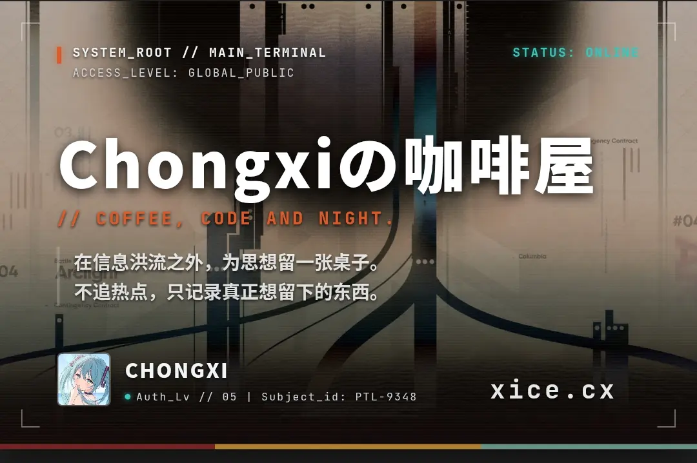

# Lonetrail

<p align="center">
  
</p>


English | [简体中文](README-zhCN.md)

A minimal Astro blog template. Static by default, bilingual out of the box, configured through YAML plus a small TypeScript file.

## Demo

👉 [Live Demo](https://lonetrail.pages.dev/)

## Features

- **Astro 7** — static output, no server required
- **Bilingual** — Chinese at `/`, English at `/en/`, with automatic fallback for untranslated pages
- **Essays** — short notes with a timeline and activity heatmap
- **Swup** — no-refresh page transitions
- **Pagefind** — full-text search index generated at build time
- **Series** — group posts into multi-part reads
- **Tags & categories** — taxonomy archives generated from content
- **Markdown** — Expressive Code, KaTeX, Mermaid, admonitions, table of contents
- **Feeds** — RSS, Atom and split sitemaps, per locale
- **Optional integrations** — Twikoo comments and Umami analytics, off by default
- **Dark mode**, **responsive**, **accessible**

## Quick Start

```bash
pnpm install
pnpm dev       # http://localhost:4321
pnpm build     # dist/ + Pagefind index
```

Node 24 or newer.

## Configuration

Site metadata lives in `src/site.yml`:

```yaml
site:
  title: "Lonetrail"
  title_en: "Lonetrail"
  subtitle: "循此苦旅 直抵群星"
  subtitle_en: "Ad Astra Per Aspera"
  url: "https://lonetrail.pages.dev"
  author: "Lonetrail"
  email: "i@chongxi.us"
  favicon: "/images/favicon.webp"
  banner: "/images/banner.webp"
  og_image: "/images/og.webp"
  avatar: "/images/avatar.webp"
  version: "CEPATO_NEXT_v27.0"
```

`version` is the label shown at the bottom of the sidebar; it is independent of the package version.

Navigation entries reference built-in labels by key:

```yaml
nav:
  - key: home
    url: "/"
  - key: archive
    url: "/archive/"
  - key: series
    url: "/seri/"
  - key: essays
    url: "/essays/"
  - key: about
    url: "/about/"
```

Feature flags and integrations live in `src/config.ts`:

```ts
export const featureConfig = {
	comments: true,
	search: true,
	analytics: "none",
};

export const integrationConfig = {
	twikoo: { envId: "" },
	umami: { websiteId: "", domains: "" },
};
```

## Content

Posts go in `src/content/posts/`:

```markdown
---
title: "My First Post"
published: 2026-01-01
description: "One-line summary"
tags: ["astro", "blog"]
category: "技术"
---

Content here...
```

Add a sibling file named `<slug>.en.md` for the English version.

Other collections:

- `src/content/essays/` — short notes
- `src/content/seri/` — series definitions
- `src/content/spec/` — standalone pages

## Deploy

`pnpm build` produces a fully static `dist/`. Any static host works — Cloudflare Pages, Vercel, Netlify, GitHub Pages, or a plain bucket.

`public/_headers` and `public/_redirects` are Netlify/Cloudflare conventions and are ignored by hosts that do not read them.

## Structure

```
src/
  site.yml         Site metadata, navigation, profile
  config.ts        Feature flags and integrations
  content/         Posts, essays, series, spec pages
  components/      UI and page components
  layouts/         Page layout
  pages/           Routes (zh at /, en at /en/)
  styles/          Tokens, markdown and theme CSS
  plugins/         Remark / rehype plugins
  i18n/            Translations and locale helpers
public/            Static assets and fonts
```

## License

MIT — use freely, no attribution required.
