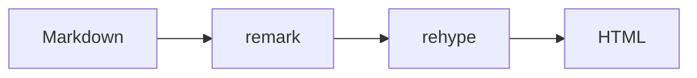

## 语法高亮

代码块由 Expressive Code 渲染，带行号、语言徽标和复制按钮；加上 `collapse` 可以折叠长代码。

```ts
type Locale = "zh" | "en";

export function localizePath(pathname: string, locale: Locale): string {
	const base = pathname.endsWith("/") ? pathname : `${pathname}/`;
	return locale === "zh" ? base : base === "/" ? "/en/" : `/en${base}`;
}
```

```bash collapse={2-6}
pnpm install
pnpm dev
pnpm build
```

## 数学公式

行内公式：$E = mc^2$，块级公式：

$$
\int_{-\infty}^{\infty} e^{-x^2} \, dx = \sqrt{\pi}
$$

## 图表



## 提示块

:::note
提示块由 `remark-directive` 解析，支持 note / tip / important / caution / warning 五种类型。
:::

:::tip
也可以用 GitHub 风格的 `> [!TIP]` 写法。
:::

## 表格

| 阶段 | 插件 | 作用 |
| --- | --- | --- |
| 解析 | remark-math | 识别公式 |
| 转换 | rehype-katex | 渲染公式 |
| 输出 | rehype-slug | 给标题加锚点 |
